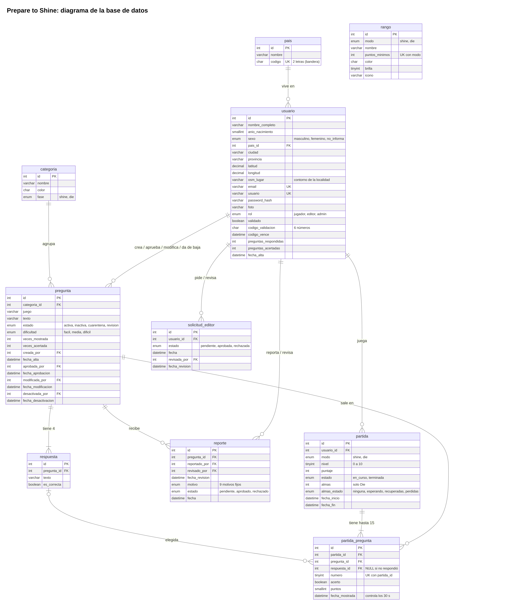

# Prepare to Shine

TP Final de Programación Web 2 (UNLaM): un juego de preguntas y respuestas sobre videojuegos.
**"El souls de los juegos de preguntas"**: empieza colorido y amable ("Prepare to Shine") y tiene un modo oscuro y difícil inspirado en los juegos de FromSoftware ("Prepare to Die").

Construido sobre el MVC de la cátedra (PHP + Mustache), sin frameworks y sin Composer: todas las librerías están incluidas en el repo (`vendor/` y `public/js/vendor/`).

Sitio en producción: <http://preparetodie.gamer.free>

Equipo: Eros, Mel y Santi.

## El juego

Hay dos modos **separados**, cada uno con su puntaje, sus rangos y su ranking:

| | Shine | Die |
|---|---|---|
| Temática | Videojuegos en general | Juegos souls |
| Estética | Colores vivos, 8 bits | Oscura, gótica |
| Categorías | Plataformas, Acción y aventura, Shooters, RPG, Lucha, Deportes y carreras | Jefes, Lore, Frases, Skills |
| Puntos | x1 | x2 |
| Extras | | Hogueras (checkpoints en la pregunta 5 y 10) y almas que se recuperan en la próxima partida |

- **Partida**: 15 preguntas. Antes de cada una se elige una carta boca abajo (la categoría la sortea el servidor). Hay 30 segundos por pregunta y el tiempo lo controla el servidor. Una respuesta mal termina la partida.
- **Puntaje por dificultad**: fácil 50, media 100, difícil 200 (x2 en Die), y 500 de bonus por completar la partida.
- **Nivel del jugador** (0 a 10, oculto): según cuánto acierta, decide la mezcla de preguntas fáciles, medias y difíciles que le tocan.
- **Dificultad de cada pregunta**: arranca con la que le pusieron al crearla y, cuando ya la respondieron 5 veces, se calcula sola con el porcentaje de aciertos.
- **Rangos**: 7 por modo, según los puntos de la semana (tabla `rango`), con íconos pixel art.

## Roles

| Rol | Qué puede hacer |
|---|---|
| **Jugador** | Jugar Shine y Die, ver el ranking y el cementerio, ver su perfil y el de otros (con QR), sugerir preguntas (3 por semana), reportar preguntas (3 por semana) y pedir ser moderador. |
| **Editor (moderador)** | Lo mismo que el jugador, sin sugerir. Además revisa las preguntas reportadas y sugeridas (aprobar, editar o rechazar) y crea preguntas nuevas (15 por semana). |
| **Administrador** | No juega. Ve las estadísticas con gráficos y las descarga en PDF, aprueba o rechaza a quienes piden ser moderadores y administra todas las preguntas (buscar, ver sus gráficos, editar, dar de baja, crear y cargar por CSV). |

El rol se controla en el `Router` con `Configuration::ROLES_POR_CONTROLLER`. Para crear un administrador se registra una cuenta común y se corre `UPDATE usuario SET rol = 'admin' WHERE usuario = '...';`.

## Funcionalidades

- **Registro y login** con validación de la cuenta por un código de 6 números enviado por mail, y **recuperar contraseña** con el mismo código.
- **Perfil propio**: foto, datos, contraseña y ubicación elegida en un mapa.
- **Perfil público** de cualquier jugador, con su ubicación en el mapa, su historial y un **código QR** que lleva a ese perfil.
- **Partida** Shine y Die (ver arriba), con animaciones de cartas y del temporizador.
- **Ranking** semanal e histórico por modo, con filtros por AJAX y miniperfil al pasar por cada jugador.
- **Cementerio** (Die): los 10 que más murieron, en lápidas pixel art con frases.
- **Sugerir pregunta** desde el lobby y **reportar pregunta** (con AJAX) después de responderla. Una pregunta reportada queda en cuarentena hasta que la revisa un moderador.
- **Quiero moderar**: un jugador que cumple los requisitos pide ser editor y el admin lo aprueba.
- **Panel del moderador** (`/editor`): reportadas, sugeridas, nueva pregunta y un buscador AJAX para no repetir preguntas.
- **Panel del administrador** (`/admin`):
  - Estadísticas por día, semana, mes, año o todo (jugadores, partidas, preguntas, aciertos, por país, sexo y edad), con gráficos y **descarga en PDF**.
  - Sección **Preguntas**: resumen y gráficos Shine/Die, buscador, detalle de cada pregunta con sus gráficos, alta manual y **carga masiva por CSV** (separado por `;`, con vista previa; carga las válidas y devuelve las que tienen errores).
  - Solicitudes para ser moderador y estado del servidor.
- **Sonidos** 8 bits con dos botones de silencio (música y efectos) que se recuerdan entre páginas.
- **Página 404** con el tema del juego.
- **Secreto** en la portada: clickear 5 veces "Shine" en el título.

## Librerías y servicios externos

Todas las librerías están **incluidas en el repo** (no hace falta instalar nada ni tener internet para que funcionen). Los servicios externos se usan desde el navegador o como imagen.

### Librerías PHP (`vendor/`)

| Librería | Versión | Dónde está | Para qué la usamos |
|---|---|---|---|
| [Mustache](https://github.com/bobthecow/mustache.php) | 2.12.0 | `vendor/mustache/`, envuelta en `helper/MustacheRender.php` | Motor de plantillas: todas las vistas son `.mustache` (`app/view/`). También arma los mails y el HTML que devuelven algunas respuestas AJAX. |
| [PHPMailer](https://github.com/PHPMailer/PHPMailer) | 6.10.0 | `vendor/phpmailer/`, envuelta en `helper/Mailer.php` | Manda los mails con el código de validación y de recuperar contraseña por SMTP de Gmail (InfinityFree no permite `mail()`). |
| [Dompdf](https://github.com/dompdf/dompdf) | 3.1.4 | `vendor/dompdf/`, envuelta en `helper/Pdf.php` | Convierte en PDF el HTML de la vista `adminPdf.mustache`: el reporte de estadísticas del admin (`/admin/pdf?periodo=`). |
| [CpChart](https://github.com/szymach/c-pchart) | 3.1.1 | `vendor/cpchart/`, envuelta en `helper/Grafico.php` | Dibuja en el servidor (con GD) los gráficos del PDF como imágenes PNG, porque Dompdf no ejecuta JavaScript. |

### Librerías JavaScript (`public/js/vendor/` y `public/css/vendor/`)

| Librería | Versión | Dónde se usa | Para qué la usamos |
|---|---|---|---|
| [GSAP](https://gsap.com) | 3.13.0 | `public/js/partida.js`, `public/js/secreto.js` | Animaciones: mezcla y vuelta de las cartas, temporizador, transición de Shine a Die en la portada. |
| [Leaflet](https://leafletjs.com) | 1.9.4 | `public/js/mapa.js` (+ `public/css/vendor/leaflet.css`) | Mapa interactivo para elegir la ubicación en el registro y en editar perfil, y para mostrarla en los perfiles. |
| [Chart.js](https://www.chartjs.org) | 4.4.7 | `public/js/admin.js`, `public/js/adminPreguntas.js`, `public/js/adminPregunta.js` | Gráficos de las estadísticas y de la sección Preguntas del admin (los datos llegan por AJAX en JSON). |

### Servicios externos

| Servicio | Dónde se usa | Para qué |
|---|---|---|
| [OpenStreetMap](https://www.openstreetmap.org) (tiles) | `public/js/mapa.js` | Las imágenes del mapa de Leaflet. |
| [Nominatim](https://nominatim.openstreetmap.org) | `public/js/mapa.js` | Pasa de coordenadas a ciudad, provincia y país (y busca el contorno de la localidad en el perfil público). Sin API key. |
| [api.qrserver.com](https://goqr.me/api/) | `helper/Qr.php`, `public/js/ranking.js` | Genera la imagen del código QR del perfil público (es solo un `` con la URL del perfil). |
| [flagcdn.com](https://flagcdn.com) | `perfilView`, `miniperfil`, `rankingFila` | Banderas de los países por su código de 2 letras. |
| [Google Fonts](https://fonts.google.com) | `app/view/header.mustache` | Tipografías: Press Start 2P y Nunito (Shine), Cinzel y EB Garamond (Die). |

Además, el deploy usa la GitHub Action [SamKirkland/FTP-Deploy-Action](https://github.com/SamKirkland/FTP-Deploy-Action) 4.3.6.

Los sonidos (`public/sonidos/`) y los íconos pixel art (`public/img/`) los generamos nosotros.

## Cómo levantarlo en local

Requisitos: PHP 8 con las extensiones `pdo_mysql`, `gd`, `dom` y `mbstring`, MySQL o MariaDB, y Apache con `mod_rewrite`.

1. Copiar el proyecto en la raíz del servidor Apache. Si queda en una subcarpeta, cambiar `RewriteBase` en `.htaccess`.
2. Crear una base vacía (por ejemplo `prepare_to_shine`, en utf8mb4) e importar en orden los scripts de `app/sql/` (ver abajo).
3. Copiar `config/config.example.ini` como `config/config.ini` y completar los datos de la BD. Si se deja `mail_user` vacío, los mails no se mandan y el código aparece en `log/`.
4. Entrar a `http://localhost/` y registrarse.

No hace falta `composer install`: `vendor/` ya está en el repo.

## Base de datos

Los scripts están en `app/sql/` y se importan en este orden:

1. `01-esquema.sql`: crea las tablas. Si ya existen, las borra y las vuelve a crear (se pierden los datos).
2. `02-datos-iniciales.sql`: países, las 10 categorías y el usuario `sistema`, autor de las preguntas iniciales (no puede iniciar sesión).
3. `03-preguntas.sql`: las 1500 preguntas iniciales, 250 por cada tipo (fácil, media y difícil de Shine y de Die), con sus 4 opciones.

`03-preguntas.sql` se genera desde `app/sql/preguntas.csv`. Para corregir o sumar preguntas se edita el CSV y se corre `php app/sql/generar-preguntas.php`.

### En InfinityFree

1. En el panel de InfinityFree, entrar a **MySQL Databases** y crear la base. Anotar host, usuario, contraseña y nombre completo de la base (con el prefijo de la cuenta).
2. Abrir **phpMyAdmin** sobre esa base y, en **Importar**, subir los tres `.sql` en orden.
3. En GitHub, en **Settings > Secrets and variables > Actions**, cargar `DB_HOST`, `DB_USER`, `DB_PASS` y `DB_NAME` con esos datos (y los del mail, ver más abajo). El deploy arma `config/config.ini` con ellos.

`app/sql/` no se sube al hosting: la base se carga a mano por phpMyAdmin.

### Diagrama

El diagrama entidad-relación está en [`docs/diagrama-bd.md`](docs/diagrama-bd.md) (en Mermaid, GitHub lo dibuja) y como imagen en [`docs/diagrama-bd.png`](docs/diagrama-bd.png).



## Deploy

Cada push a `main` corre la GitHub Action `.github/workflows/deploy.yml`, que:

1. Arma `config/config.ini` con los secrets `DB_HOST`, `DB_USER`, `DB_PASS`, `DB_NAME`, `MAIL_USER` y `MAIL_PASS`.
2. Sube los archivos por FTP a InfinityFree (secrets `FTP_SERVER`, `FTP_USERNAME`, `FTP_PASSWORD`), sin `app/sql/`, `docs/`, `log/`, el README ni la carpeta `.github`.

También se puede correr a mano desde la pestaña **Actions**.

## Estructura

```
index.php              Front controller: arma Configuration y despacha /controller/method
.htaccess              URLs limpias, 404 y bloqueo de carpetas internas
config/                Configuración local (config.ini no se versiona)
app/Configuration.php  Arma cada controller con sus dependencias, rutas públicas y roles
app/controller/        Controllers (Login, Registro, Recuperar, Home, Partida, Ranking, Perfil, Pregunta, Editor, Admin, Error)
app/model/             Models (acceso a la BD y reglas del juego)
app/view/              Vistas .mustache (header.mustache y footer.mustache incluidos)
app/sql/               Scripts de la base de datos y generador de preguntas
helper/                Router, Autoloader, MyDatabase, MustacheRender, Request, Redirect, Log, Sesion, Mailer, Pdf, Grafico, Qr
vendor/                Librerías PHP (Mustache, PHPMailer, Dompdf, CpChart)
public/                Archivos estáticos (css, js, imágenes, sonidos)
docs/                  Diagrama de la base de datos
log/                   Logs diarios (no se versionan)
```

Para agregar una pantalla: crear Controller + Model + View y sumar su `get{Nombre}Controller()` en `app/Configuration.php`.

## Login y registro

Sin sesión solo se puede entrar a `/login`, `/registro`, `/recuperar` y a la página 404 (la lista está en `Configuration::CONTROLLERS_PUBLICOS` y la controla el `Router`); cualquier otra página manda al login.

1. `/registro` crea la cuenta sin validar y manda por mail un código de 6 números que vence a los 10 minutos.
2. `/registro/validar` pide el código. "Reenviar código" genera uno nuevo y el anterior deja de servir. Después de 5 intentos fallidos el código se anula.
3. Si la persona se va sin validar, la cuenta queda creada. Al loguearse se le manda un código nuevo y tiene que validarla antes de entrar.

Las contraseñas se guardan con `password_hash`. Las fotos de perfil se suben a `public/img/perfiles/` (no se versionan); sin foto se usa `public/img/avatar.svg`.

### Recuperar contraseña

En el login, "¿Olvidaste tu contraseña?" lleva a `/recuperar`: se escribe el mail o el usuario y llega el mismo código de 6 números que en el registro (también vence a los 10 minutos y se anula después de 5 intentos). Con el código se elige la contraseña nueva. La respuesta es siempre la misma, exista o no la cuenta, para no revelar quién está registrado.

### Mail

Los mails salen por SMTP con PHPMailer (`vendor/phpmailer/`, envuelto en `helper/Mailer.php`), porque InfinityFree no permite `mail()`. Se usa la cuenta de Gmail del juego con una **contraseña de aplicación**:

1. En la cuenta de Google, activar la **Verificación en 2 pasos** (sin eso no aparece la opción de contraseñas de aplicación).
2. Crear una contraseña en <https://myaccount.google.com/apppasswords>.
3. En GitHub, cargar los secrets `MAIL_USER` (el mail) y `MAIL_PASS` (la contraseña de 16 letras, sin espacios). El deploy los escribe en `config/config.ini`.

En local, si `mail_user` queda vacío en `config.ini`, no se manda nada: el mail (con el código) se escribe en `log/`.
