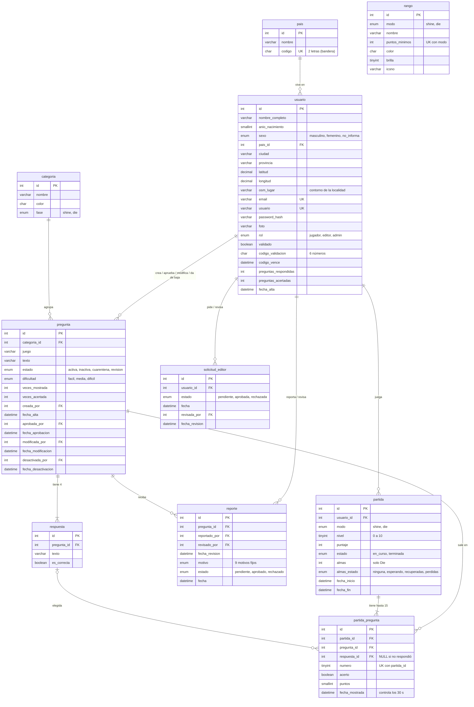

# Diagrama de la base de datos

Sale de `app/sql/01-esquema.sql` (que ya incluye todos los cambios hechos durante el TP). La misma imagen está en [`diagrama-bd.png`](diagrama-bd.png).

## Notas

- `rango` no tiene claves foráneas: el rango de cada jugador se calcula con sus puntos de la semana en cada modo.
- Los rankings (semanal, histórico y cementerio) tampoco se guardan: se calculan a partir de `partida`.
- `reporte` tiene `UNIQUE (pregunta_id, reportado_por)`: cada jugador reporta una misma pregunta una sola vez.
- `pregunta.estado`: `revision` = sugerida por un jugador, `cuarentena` = reportada, `inactiva` = dada de baja.
- El usuario con id 1 es `sistema`, autor de las 1500 preguntas iniciales (no puede iniciar sesión).
